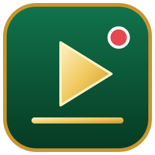
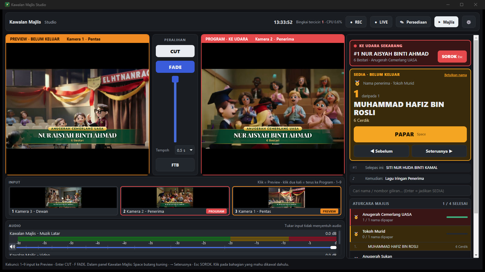
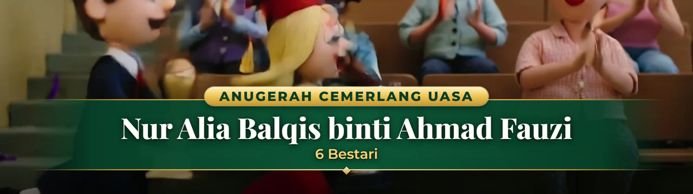

<div align="center">



# Kawalan Majlis Studio

**Siaran langsung dan rakaman majlis sekolah, macam studio TV.**<br>
Tukar kamera, papar nama penerima, main lagu dan slaid. Semua dalam satu skrin.


### [⬇️ Muat turun versi terkini (Windows)](https://alat.cikguaime.com/kawalan-majlis)

<sub>Versi beta. Oleh cikgu, untuk cikgu.</sub>

</div>

---



## Kenapa aplikasi ini dibina?

Cikgu yang pernah jadi AJK livestream majlis mesti faham. 🥲

Satu tangan tukar kamera. Satu tangan cari nama murid. Telinga dengar pengacara.
Mata pandang skrin OBS yang penuh butang. Tersilap tekan, satu dewan nampak.

Kawalan Majlis Studio susun semua itu dalam **satu skrin yang jelas**, dengan butang besar dan
peraturan yang menjaga cikgu daripada tersilap semasa majlis berjalan.

## Apa yang cikgu boleh buat

| Ciri | Apa cikgu buat |
|---|---|
| 🎥 **Tukar kamera macam studio TV** | Klik kamera (atau tekan 1, 2, 3) untuk sediakan di **PREVIEW**. Tekan **CUT** atau **FADE** untuk keluar ke **PROGRAM**. Ada T-bar dan FTB (skrin hitam). |
| 🏅 **Nama penerima dari Excel** | Masukkan senarai (Nama, Kelas, Anugerah). Semasa majlis, nama seterusnya sentiasa sedia dalam kotak kuning. Tekan **PAPAR**. Siap. |
| 🎵 **Lagu dan video** | Main lagu iringan, Negaraku, video sekolah. Semasa lagu dimainkan, butang dikunci supaya lagu tak terpotong. |
| 🖼️ **Slaid Canva dengan animasi** | Tampal pautan Canva. Tukar slaid dengan butang ◀ ▶ atau clicker. Slaid PDF dan gambar pun boleh. |
| 📽️ **Skrin projektor** | Tangkap skrin kedua (contohnya Canva Present) sebagai satu input. |
| 📹 **Kamera PTZ / NDI** | Kamera rangkaian NDI terus dikesan. Kamera USB dan kad HDMI capture juga boleh. |
| 🎶 **Muzik latar** | Muzik berulang semasa menunggu, mengecil sendiri bila lagu aturcara dimainkan. |
| 🔴 **Rakam dan siar langsung** | REC dan LIVE ke YouTube atau Facebook. Henti siaran perlu ditahan 2 saat (elak tertekan). |

### Kad nama yang cantik, boleh direka sendiri



Pilih templat (termasuk **Kad hijau emas**), tukar fon dan warna, atau letak gambar latar sendiri.
Nama yang panjang mengecil sendiri supaya kekal kemas dalam kad.

## Mula dalam 5 minit

1. **[Muat turun zip](https://github.com/ahmdaime/kawalan-majlis-studio/releases)** dan ekstrak, contohnya ke `C:\Kawalan Majlis Studio`.
2. Klik dua kali **`BUKA Kawalan Majlis Studio.bat`**.<br>
   <sub>Jika Windows bertanya (SmartScreen): *More info* → *Run anyway*. Aplikasi ini belum ditandatangani secara digital.</sub>
3. Di panel kanan, tekan **Persediaan** dan ikut langkah 1 hingga 6: sambung, senarai penerima, aturcara, slaid Canva, muzik latar, reka paparan nama.
4. Tekan **Majlis**. Sedia!

Kamera NDI (contohnya kamera PTZ): pasang [NDI Tools](https://ndi.video/tools/download/) (percuma).
Studio akan beritahu jika NDI belum dipasang.

## Semasa majlis

| Kekunci | Apa berlaku |
|---|---|
| `1` – `9` | Pilih kamera / input ke PREVIEW |
| `Enter` | CUT ke PROGRAM |
| `F` | FADE ke PROGRAM |
| `Space` | **PAPAR** (butang kuning) |
| `→` / `←` | Nama atau item seterusnya / sebelum |
| `Esc` | SOROK nama. Untuk lagu: tekan dua kali untuk HENTI |
| `PageDown` / `PageUp` | Clicker: tukar slaid Canva semasa ke udara |

Dalam panel: **kotak KUNING** = sedia, belum keluar. **Kotak MERAH** = sedang ke udara. Nama, lagu dan slaid hanya keluar ke skrin bila cikgu tekan butang kuning.

## Soalan lazim

<details>
<summary><b>Betul ke percuma?</b></summary>

Ya. Percuma dan sumber terbuka (lesen GPL). Cikgu boleh guna, salin dan kongsi dengan sekolah lain.
</details>

<details>
<summary><b>Perlu internet?</b></summary>

Tidak, kecuali untuk slaid Canva (dimuat dari internet) dan siaran langsung. Nama, lagu, video dan slaid PDF berfungsi tanpa internet.
</details>

<details>
<summary><b>Laptop macam mana yang sesuai?</b></summary>

Windows 64-bit (diuji pada Windows 11; Windows 10 belum diuji). Untuk 3 kamera NDI dan siaran langsung, laptop dengan kad grafik (contohnya laptop gaming) lebih selesa.
</details>

<details>
<summary><b>Ada untuk Mac?</b></summary>

Studio ini untuk Windows sahaja buat masa ini. Pengguna Mac boleh cuba <a href="https://github.com/ahmdaime/kawalan-majlis">panel Kawalan Majlis</a> di dalam OBS Studio biasa (pemasang Mac masih dalam ujian).
</details>

<details>
<summary><b>Saya dah biasa dengan OBS. Boleh guna tetapan OBS penuh?</b></summary>

Boleh. Tekan butang ⚙ (Tetapan lanjutan) untuk membuka semua tetapan OBS: sumber, audio, siaran, rakaman.
</details>

## Mahu membantu? 🙏

Versi ini masih **beta**. Cara paling mudah untuk membantu:

- **Uji di sekolah cikgu**, kemudian ceritakan pengalaman di tab **[Issues](https://github.com/ahmdaime/kawalan-majlis-studio/issues)**. Sertakan gambar skrin.
- **Ada idea?** Kongsi juga di Issues. Cadangan cikgu sangat dialu-alukan.
- **Tahu menulis kod?** Hantar Pull Request. Panduan di bawah.

<details>
<summary><b>Untuk pembangun: struktur kod, membina dan ujian</b></summary>

Kawalan Majlis Studio ialah fork bebas [OBS Studio](https://obsproject.com) 32.0.4.

- Bilik Kawalan (Qt, native): `frontend/widgets/BilikKawalan.*`
- Panel Pengarah (web, dimuat dalam Studio): submodul `kawalan-majlis/` ([repo berasingan](https://github.com/ahmdaime/kawalan-majlis))
- Kamera NDI: [DistroAV](https://github.com/DistroAV/DistroAV), disalin ke pakej keluaran

**Membina (Windows):** Visual Studio 2022, CMake 3.28+, Windows SDK 10.0.22621+. Bina di pemacu NTFS (bukan exFAT).

```
git clone --recursive https://github.com/ahmdaime/kawalan-majlis-studio.git
cd kawalan-majlis-studio
cmake --preset windows-x64
cmake --build build_x64 --config RelWithDebInfo
```

Hasil: `build_x64\rundir\RelWithDebInfo\bin\64bit\obs64.exe`.
Panduan penuh OBS: [Build Instructions For Windows](https://github.com/obsproject/obs-studio/wiki/Build-Instructions-For-Windows).

**Ujian hidup** (memandu aplikasi sebenar melalui obs-websocket dan CDP, tanpa tetikus): lihat [`km-ujian/README.md`](km-ujian/README.md).
Ujian panel tanpa OBS: `node kawalan-majlis/ujian/uji-aturcara.cjs`.
</details>

## Lesen

GNU General Public License versi 2 atau kemudian (GPL-2.0-or-later), sama seperti OBS Studio. Lihat [`COPYING`](COPYING).

Hak cipta OBS Studio milik penyumbang OBS Project. Tambahan Kawalan Majlis (c) 2026 Cikgu Aime dan penyumbang.
Kawalan Majlis Studio **bukan** produk rasmi OBS Project dan tidak disokong oleh mereka; nama dan logo "OBS"
ialah tanda dagangan OBS Project. README asal OBS Studio: [`README.rst`](README.rst).
